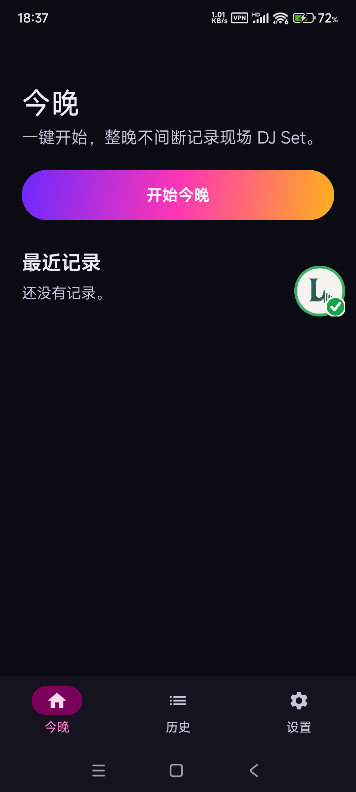
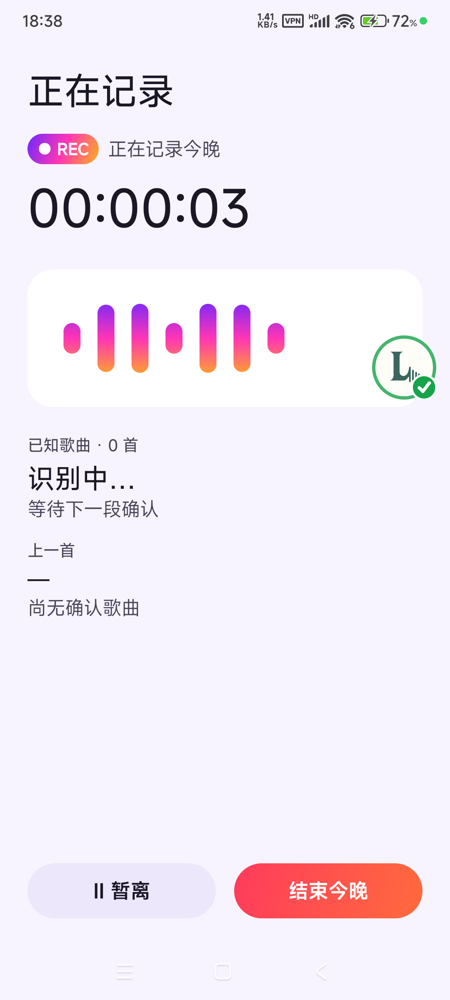
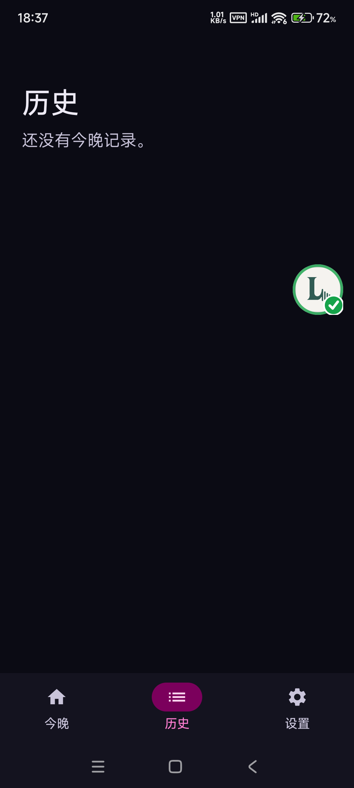

# NightRec

Tap "Start tonight" once at a bar or club, then lock the phone or reply to messages without interrupting it. NightRec keeps the whole night's live DJ set as one continuous recording and marks where each song and transition happened.

[简体中文](./README.md) | English

<p>
  
  
  
</p>

## What it solves

Music in a bar or club is continuous: one track follows another, with DJ transitions, host announcements, and room sound in between. With a normal recorder, locking the screen can stop capture, a phone call interrupts it, and leaving the venue forces a separate file. With a recognition app, you end up with a list of song names but not the actual night.

NightRec keeps the live original first and annotates it afterwards. The whole night is one session, recording is split into five-minute safety segments, and the interface still presents a single continuous progress bar. Songs and transitions are markers layered on top, and tapping one jumps back to that live moment.

## Core capabilities

### Continuous all-night recording

- One tap on "Start tonight" starts capture in a microphone foreground service. Locking the screen, switching to ordinary apps, or replying to messages does not interrupt it, and a persistent recording notification stays visible.
- Capture is 48 kHz stereo PCM16, written as AAC-LC / M4A. Mono devices fall back to the negotiated channel count instead of hard-coding stereo.
- Every five minutes a safety segment is sealed with fsync, an atomic rename, and a SHA-256 checksum. An abnormal interruption loses at most the current unsealed segment.
- At start you can enter a name and location, and separately choose whether to enable AI cleanup and live recognition. All of these can be skipped.

### Stepping away without breaking the night

- Tapping "Away" seals the current segment and stops the microphone.
- Tapping "I'm back" resumes the same session and leaves a real time gap on the timeline instead of cutting it out.
- Playback skips away gaps by default, while the gap remains inspectable for checking the real timeline.

### Recognition while recording

- Recognition uses AudD, and requests start only when both the global recognition setting and the per-session live-recognition toggle are on.
- Recognition runs on 12-second windows with a 12-second step. Windows below the RMS threshold are treated as silence and are not uploaded; after a hit, no request is sent for 60 seconds.
- Duplicate results are de-duplicated, and single A+B mix hits do not cause unstable jumps. Unrecognized ranges are kept as unknown segments.
- After the night ends, unknown ranges can be backfilled, and the player also offers "re-recognize unmatched ranges" manually.
- Requests are bounded by a local budget (`AUDD_REQUEST_LIMIT`, default 300). When the budget is exhausted, only online recognition pauses; capture and playback continue.

### Replay as soon as you stop

- Ending requires a second confirmation. The live original is playable immediately and does not wait for processing.
- The player treats multiple physical segments as one all-night progress bar. Song markers jump directly to the corresponding live position.
- You can switch between "Live original" and "Clean" while keeping the same playback position.
- Favourite ranges, marker deletion, and marking a marker as an away period are supported. Corrections change markers only and never modify audio.
- Playback runs in a Media3 / ExoPlayer `MediaSessionService` and continues in the background.

### Conservative Clean (Beta)

- Clean reads original segments and applies local, gentle channel ducking, writing a derived WAV into a separate `clean/v1/` directory. The original is never written.
- A derived version is produced only when trusted nearby-speech windows are detected. With no trusted window, the engine explicitly reports that nothing was produced and playback falls back to the live original.
- It is not source separation and does not remove vocals for the whole night. Protecting the original vocal, DJ transitions, and room sound comes first.

### Failure recovery and storage

- Capture failures become standardized errors, and the session moves through interrupted, recovering, and recording again. A single microphone failure is not treated as the end of the night.
- A damaged tail segment is isolated, while sealed complete segments remain playable.
- Low storage prioritizes keeping what has already been recorded. Original auto-deletion is fixed off in V1 and never runs silently in the background.
- Settings expose theme (follow system / light / dark), audio quality information, Clean status, recognition budget, and storage usage.

## Quick Start

Requirements: JDK 17, Android SDK (`compileSdk` / `targetSdk` 36), and a device or emulator running Android 10 (API 29) or later. Android Gradle Plugin 9.4.0 and Gradle 9.6 come from the repository wrapper.

```bash
# 1) Set sdk.dir in local.properties, or use ANDROID_HOME / JAVA_HOME

# 2) Build the debug APK
./gradlew assembleDebug
# output: app/build/outputs/apk/debug/app-debug.apk

# 3) Install on a connected device
./gradlew installDebug
# or: adb install -r -t app/build/outputs/apk/debug/app-debug.apk
```

After launch, confirm the privacy notice and grant microphone permission. Without microphone access the app shows a repair entry point and does not start recording.

### Recognition configuration

The app itself needs only device permissions. Recognition is optional; for real recognition, fill in `local.properties` (already ignored by `.gitignore`):

| Key | Description |
| --- | --- |
| `AUDD_API_TOKEN` | AudD recognition service API token |
| `AUDD_REQUEST_LIMIT` | Local request budget cap, default `300` |

The current `app/build.gradle.kts` writes the token into `BuildConfig` for both debug and release builds, and prefers the `AUDD_API_TOKEN` environment variable. Do not distribute builds containing a real token, and do not commit the token.

## Data and privacy

- Recordings, segment checksums, markers, favourites, and settings live in app-private storage and a local Room database. There is no account, cloud sync, or third-party backup.
- `allowBackup=false`, so Android system backup does not take the recordings.
- With recognition enabled, 12-second audio windows are uploaded to AudD for identification. This is the only path that sends live audio to a cloud service. With recognition off, no recognition request is made.
- Unrecognized ranges are kept; audio is not deleted just because no song title was matched.
- The app has no export or share entry for recordings; files remain in app-private storage.
- There is no separate license; the repository is used as a private project.

## Known limitations

- Recognition depends on AudD's shared quota. The repository record shows that on 2026-10-03 the server quota was exhausted (`code=902`), and at that time live recognition, backfill, and manual re-recognition all failed. Whether it has recovered since then is not verified in the repository. Capture, playback, and all-night retention are unaffected, and there is no automatic payment.
- Recognition needs a real loudspeaker source. With wired earphones the microphone physically cannot pick up the sound, so recognition cannot be verified.
- Clean is a conservative Beta that only ducks speech windows. It does not guarantee lossless speech removal and does not perform all-night vocal separation. When no trusted window exists, no derived version is produced.
- The current build is debug: `versionName` is `1.0.0-debug` and `versionCode` is 1, with no release signing or obfuscation. It is not a store release.
- Only an Android project exists; there is no iOS version, and the UI is locked to portrait.
- There is no recording export, sharing, or cloud sync entry, so data does not migrate automatically when changing devices or uninstalling.

## License

No license is provided (private project).
