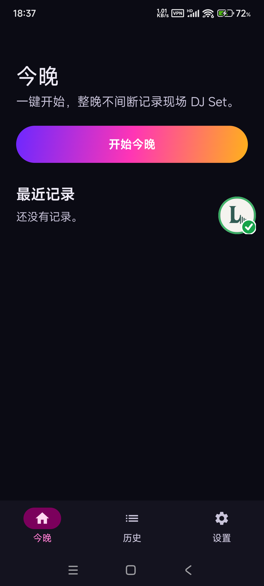
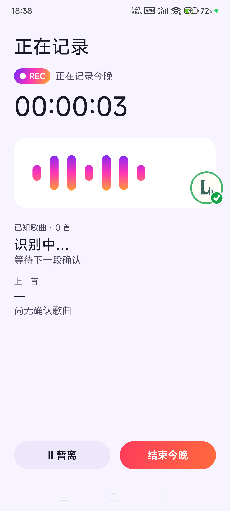
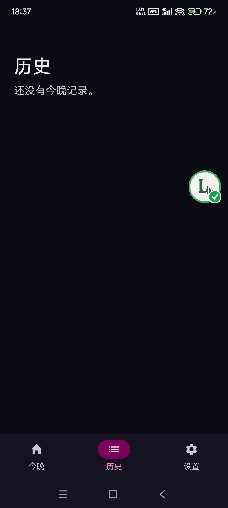

# NightRec

在酒吧或 Club 点一次「开始今晚」，之后锁屏、回消息都不影响；它把整晚的现场 DJ Set 留成一条连续录音，并标出歌曲与转场位置。

[English](./README.en.md)

<p>
  
  
  
</p>

## 它解决什么问题

酒吧和 Club 的音乐是连续的：一首歌接一首歌，中间夹着 DJ 转场、主持讲话和环境声。用普通录音软件，锁屏可能被系统停掉，来电会打断，中途离场只能另起一段；用识曲软件，最后拿到的是一串歌名，回听时听不到昨晚真实的现场。

NightRec 先完整留住现场原声，再在音轨上做标记。整晚是一个 Session，录音被切成 5 分钟的安全分片，界面里仍然是一条连续的整晚进度条；歌曲和转场是叠加在上面的 Marker，点一下就能跳回昨晚的现场位置。

## 核心能力

### 整晚连续录制

- 首页一键「开始今晚」，录音由麦克风前台服务承载；锁屏、切换普通应用、回消息都不会中断，通知栏保留持续录音通知。
- 采集格式为 48 kHz、双声道 PCM16，写入 AAC-LC / M4A；单声道设备按实际协商结果回退，不硬编码声道数。
- 每 5 分钟切一个安全分片，封口时执行 fsync、原子重命名并写入 SHA-256；异常中断最多损失当前未封口的一段。
- 开始时可填名称、地点，并分别选择是否启用 AI 净化与实时识曲；这些都可以跳过，直接开始。

### 暂离不拆场

- 需要离开时点「暂离」：当前分片安全封口，麦克风停止。
- 回来后点「回来了，继续记录」：仍属同一个 Session，时间轴留下一段真实的时间缺口，不把缺口剪掉。
- 播放时默认跳过暂离缺口；需要核对现场时间时，缺口位置仍然可查。

### 边录边识曲

- 识曲使用 AudD；只在「设置里的全局识曲开关」与「本次开始时的实时识曲勾选」同时为真时才会发请求。
- 12 秒窗口、12 秒步长连续识别；窗口 RMS 低于阈值时视为静音，不发请求；命中一首歌后 60 秒内不重复上传。
- 重复结果去重，A+B 混合命中时避免在单次结果上乱跳；未识别区间保留为未知段。
- 结束后可对未命中段做补识别，也可以在播放器里手动「重新识别未命中段」。
- 识曲请求受本地预算上限约束（`AUDD_REQUEST_LIMIT`，默认 300），额度耗尽只暂停网络识曲，采集与播放继续。

### 结束即回听

- 结束需要二次确认；结束后现场原版立即可播，不需要等待处理完成。
- 播放器把多个物理分片当成一条整晚进度条，歌曲 Marker 直接跳到对应的现场位置。
- 可在「现场原版 / Clean」之间切换，切换时保持同一播放位置。
- 支持收藏此段、删除标记、把标记标为暂离；纠错只改标记，绝不修改音频。
- 播放由 Media3 / ExoPlayer 的 `MediaSessionService` 承载，支持后台播放。

### 保守 Clean（Beta）

- Clean 只读原版分片，做局部、温和的通道 ducking，把派生 WAV 写到独立的 `clean/v1/` 目录，原版永不写入。
- 只有在检测到可信的近距离讲话窗口时才输出派生版本；没有可信窗口时明确返回「未产出」，回退到现场原版。
- 它不是声源分离，也不做整晚 Remove Vocals；主唱、DJ 转场与现场氛围以保住原版为先。

### 异常恢复与存储

- 采集失败会转成标准错误，Session 进入「中断 → 恢复中 → 继续录制」，不会把一次麦克风异常当成整晚结束。
- 损坏的尾部分片会被隔离，已封口的完整分片继续可播。
- 低存储时优先保住已经录下的原版；Original 自动删除在 V1 固定关闭，不会后台悄悄清理。
- 设置页提供主题（跟随系统 / 浅色 / 深色）、音质信息、Clean 状态、识曲额度与存储占用。

## 快速开始

前置：JDK 17、Android SDK（`compileSdk` / `targetSdk` 36）、一台 Android 10（API 29）及以上的真机或模拟器。Android Gradle Plugin 9.4.0、Gradle 9.6 由仓库的 wrapper 提供。

```bash
# 1) 在 local.properties 写入 sdk.dir，或使用 ANDROID_HOME / JAVA_HOME

# 2) 构建 debug APK
./gradlew assembleDebug
# 产物：app/build/outputs/apk/debug/app-debug.apk

# 3) 安装到已连接的设备
./gradlew installDebug
# 或：adb install -r -t app/build/outputs/apk/debug/app-debug.apk
```

启动后先确认隐私说明并授予麦克风权限；没有麦克风权限时应用会给出修复入口，不会进入录制。

### 识曲配置

应用本身只需要设备权限即可使用。识曲是可选能力；需要真实识别时，在 `local.properties` 中填写（该文件已被 `.gitignore` 忽略）：

| 键 | 说明 |
| --- | --- |
| `AUDD_API_TOKEN` | AudD 识曲服务的 API Token |
| `AUDD_REQUEST_LIMIT` | 本地请求预算上限，默认 `300` |

当前 `app/build.gradle.kts` 会把 Token 写入 debug 与 release 两种构建的 `BuildConfig`，并且优先读取环境变量 `AUDD_API_TOKEN`。不要把带真实 Token 的构建产物分发出去，也不要把 Token 提交到仓库。

## 数据与隐私

- 录音、分片校验和、标记、收藏与设置保存在应用私有目录与本机 Room 数据库；没有账号、云同步或第三方备份。
- `allowBackup=false`，Android 系统备份不会带走录音数据。
- 开启识曲时，12 秒音频窗口会上传到 AudD 做识别；这是唯一会把现场音频发到云端的路径。关闭识曲后不发任何识别请求。
- 未识别区间会被保留，不会因为没有命中歌名而删除音频。
- 应用不提供导出或分享录音的入口；文件留在应用私有存储内。
- 当前没有独立 License，仓库按私有项目使用。

## 已知限制

- 识曲依赖 AudD 的共享额度。仓库记录显示 2026-10-03 服务端额度已耗尽（`code=902`），当时实时识曲、补识别与手动重识别都无法命中；现在是否恢复，仓库内未验证。采集、播放与整晚留存不受影响，也不会自动付费。
- 识曲需要真实外放音源；有线耳机场景下麦克风收不到声音，无法验证识别。
- Clean 是保守 Beta，只做讲话窗口的通道 ducking，不保证无损去除讲话，也不做整晚人声分离；无可信窗口时不产出派生版本。
- 当前为 debug 构建：`versionName` 为 `1.0.0-debug`、`versionCode` 为 1，没有 release 签名与混淆，不是应用商店发布包。
- 只有 Android 工程，没有 iOS 版本；界面固定竖屏。
- 没有录音导出、分享或云端同步入口；换机或卸载后数据不会自动迁移。

## License

仓库未附带开源许可证（私有项目）。
